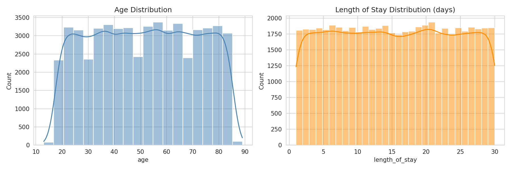
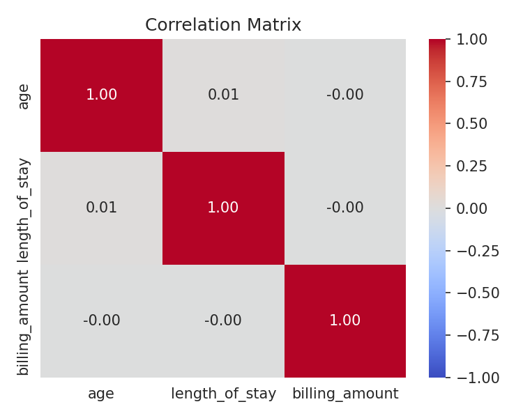

# Hospital Patient Admissions Analysis

## Overview
End-to-end analytics project on a public healthcare dataset (55,500 records):
data cleaning, SQL analysis, exploratory data analysis, and an interactive
Power BI dashboard.

## Business Questions
- How do admissions vary by medical condition, month, and weekday?
- What is the average length of stay and billing by admission type?
- Do age, length of stay, and billing amount relate to each other?

## Tools Used
Python (Pandas, Matplotlib, Seaborn), MySQL, Power BI (DAX), Google Colab

## Process
1. **Data cleaning:** removed 534 duplicate records and 106 invalid negative
   billing records; created length of stay, age group, and admission month
2. **SQL analysis:** queries using GROUP BY, CTEs, and window functions
   (RANK, LAG)
3. **EDA:** distributions, boxplot, weekday-month heatmap, correlation matrix
4. **Dashboard:** 4-page interactive Power BI report with DAX measures and slicers

## Key Findings
- Admissions are evenly spread across six medical conditions (16.5% to 16.8% each)
- Billing is nearly identical across admission types (under 0.5% difference)
- No meaningful correlation between age, length of stay, and billing amount

## Note on the Data
The dataset appears to be synthetic, so this project demonstrates the
analytics workflow rather than real clinical conclusions.

## Dashboard Preview

## EDA Charts

## Project Structure
- `data/` cleaned dataset
- `notebooks/` Python cleaning and EDA
- `sql/` SQL queries
- `dashboard/` Power BI file
- `images/` screenshots

## Dataset Source
Kaggle: "Healthcare Dataset" (paste the link here)

## Author
Arsha H R
